# pitwall
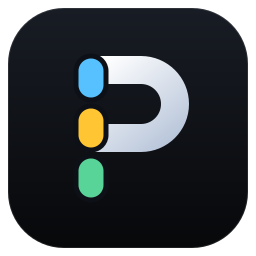

pitwall is a desktop terminal for running several coding agents at once,
with a sidebar that shows what each one is doing right now.

Run five agents in five tabs and one of them is always stuck waiting on
you, on a permission prompt or a question you have not seen. pitwall lights
up that tab, notifies you, and takes you there with one key.

- Free and open source, under the MIT license. No account.
- A desktop app for Linux, macOS and Windows, on x86_64 and arm64.
- Works with Claude Code, Codex, OpenCode, Gemini CLI, Cursor CLI, pi and
  Oh My Pi.
- Installs with one command.

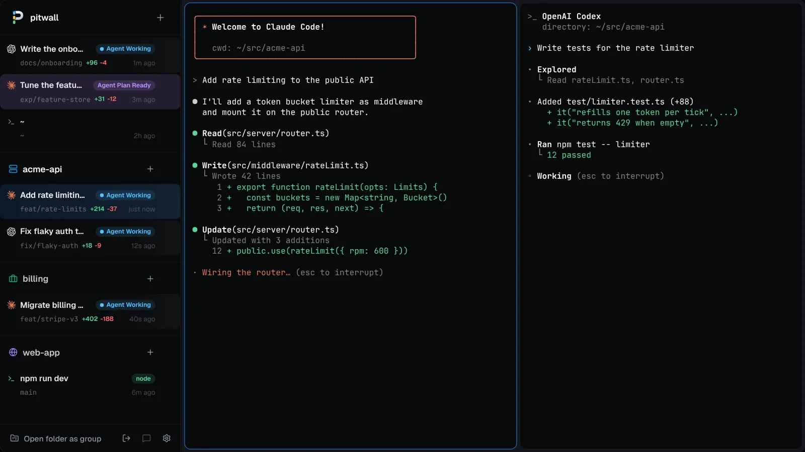

## Install

```sh
brew install quanticstudios/tap/pitwall   # macOS or Linux, with Homebrew
curl -fsSL https://raw.githubusercontent.com/quanticstudios/pitwall/main/scripts/get.sh | sh   # or the script
```

```powershell
scoop bucket add quanticstudios https://github.com/quanticstudios/scoop-bucket
scoop install pitwall                     # Windows, with Scoop
irm https://raw.githubusercontent.com/quanticstudios/pitwall/main/scripts/get.ps1 | iex   # or the script
```

Then run `pitwall`. The first window lists the agents on your `PATH` and
sets up their status reporting with one button. pitwall runs every day on
Linux; the macOS and Windows builds are newer. When a release is out, an
Update button installs it, and your tabs and config carry over.
[docs/install.md](docs/install.md) covers platforms, pinning a version,
updates and building from source.

## Try it in five minutes

Use a git repo you don't mind agents changing. On macOS the keys below
are Cmd+U, Cmd+Shift+Y, Cmd+Shift+N, Cmd+Shift+R and Cmd+T.

1. **Start two or three agents.** Run `pitwall` in the repo and press
   Install hooks on the welcome card (or in Settings, Agents), so the
   agents report their state.
   Ctrl+Shift+T opens a tab; run `claude` in one, `codex` in another, and
   give each a task that runs a command.
2. **Watch the sidebar.** Each tab's row reads Working, Input, Approval,
   Plan, Done or Error, with the branch and the lines changed.
3. **Press Ctrl+Shift+U.** When an agent stops to ask, its row lights up
   and a desktop notification arrives. The key takes you to the agent that
   started waiting most recently; press it again for the next one.
4. **Allow or Deny.** A Claude Code or Codex permission prompt puts Allow
   and Deny on the row. Click them, or press Ctrl+Shift+Y or Ctrl+Shift+D.
   To answer from a phone, turn it on in Settings, Phone, press Pair and
   scan the QR code; the phone has to reach your computer, for example over
   Tailscale
   ([docs/phone.md](docs/phone.md)).
5. **Ask for a fleet.** Tell Claude Code or Codex "split this across three
   workers". Each worker gets its own worktree and tab, folded into the
   orchestrator's row as a bar of their states. Click the bar to list them.
6. **Review and comment.** Ctrl+Shift+R opens the tab's changes. Click a
   line number, type a comment and press Enter. The Send comments button
   types them all into the agent as one prompt.

## What you get

### See every agent at a glance

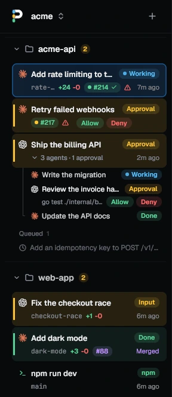

**Every tab's row says what its agent is doing: Working, Input, Approval,
Plan, Done or Error.** A tab with three agents in split panes lists each on
its own line. The row also shows the branch, the lines changed, and the pull
request with its CI and review. Merge it from the tab's menu; once merged,
Archive closes the tab and removes its worktree and branch.

### Get to the one that needs you

**Ctrl+Shift+U jumps to the agent that started waiting most recently, in any
session.** Its pane gets a ring in the state's color and you get a desktop
notification. Press the key again for the next one. Any command can ask
too: `npm test && pitwall notify "tests passed"`.

<br clear="right">

### Answer without switching windows

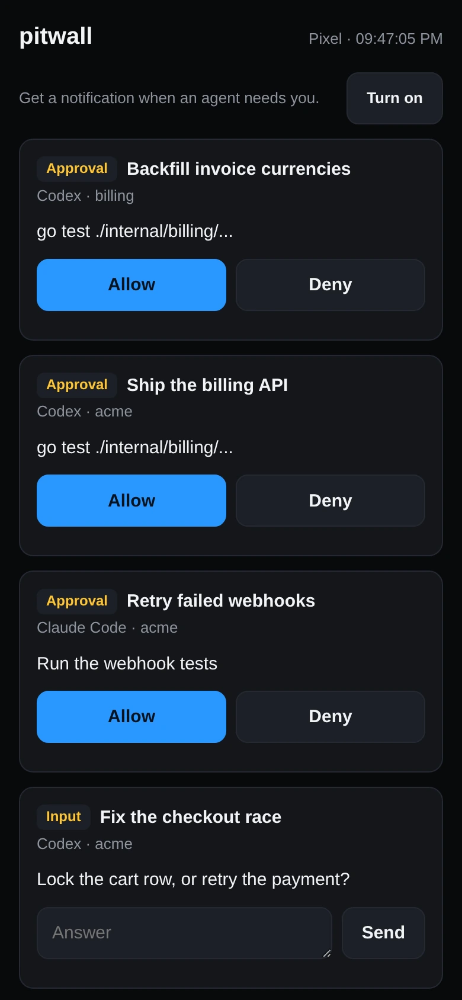

**Allow or Deny a permission prompt from the sidebar or your phone.**
Ctrl+Shift+Y and Ctrl+Shift+D press the row's buttons, and on Linux the
notification has them too. Pair your phone by QR code and it lists what
needs you, takes typed answers and gets push notifications while locked.
There is no account and no relay: the phone talks to your computer over
your own network.

<br clear="right">

### Run a fleet of workers

**Ask Claude Code or Codex to split a job and it starts one worker per
task, each in its own worktree, under its own tab.** The orchestrator's row
gets a bar with a segment per worker in its state's color, and counts of
how many need you, failed, are working and are done. The workers start
folded into that row, so ten of them take one row; click the bar to open
the tree and watch or type into any of them.

The orchestrator waits with `pitwall wait --children`. It stops at the
first worker that asks a question, and Ctrl+Shift+U takes you to it. When a
worker's pull request merges, Archive removes its tab, worktree and branch.

```sh
pitwall worktree new invoice-pdf -- claude "Render invoices as PDFs"
pitwall worktree new webhook-retry -- codex "Retry failed webhooks"
pitwall wait --children --until done --timeout 30m
```

`pitwall hooks install` teaches both agents these commands, so "split this
across three workers" is all you have to say.

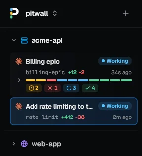 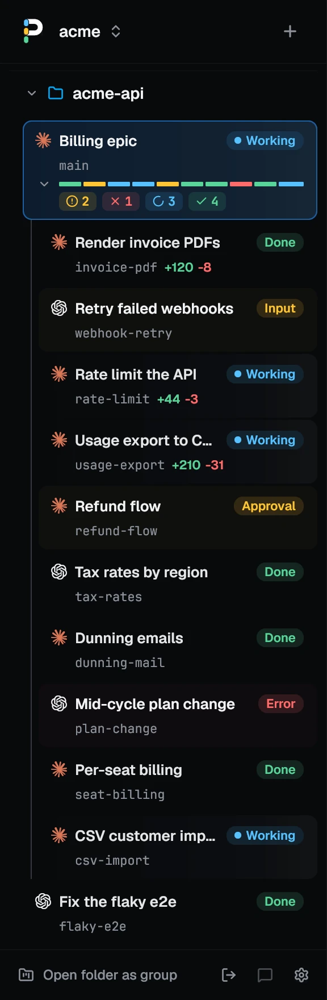

### Review what the agent changed

**Ctrl+Shift+R opens the tab's changes. Comment on any line, then send all
the comments to the agent as one prompt.** Untracked files are included.
Tick off the files you have read; one the agent touches again comes back
unticked. Throw away a file's changes with one button.

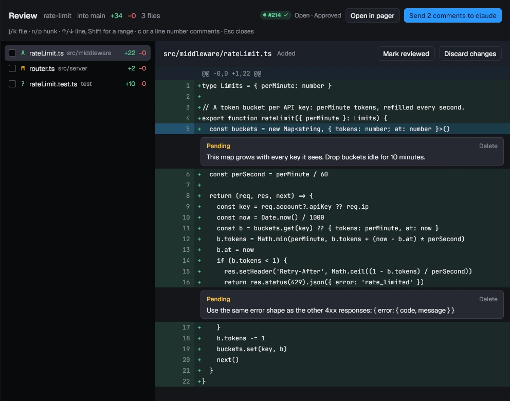

### Run agents side by side without collisions

**Give each agent its own git worktree, and pitwall warns you when two of
them edit the same file.** Start one from any branch or a pull request
number. Each gets its own ports (3010-3019, then 3020-3029), so two dev
servers stop fighting over 3000, and can copy `.env` and run your setup
command. Rows turn amber when two branches touch the same files and red
when merging would conflict; the hover card says which to merge first.

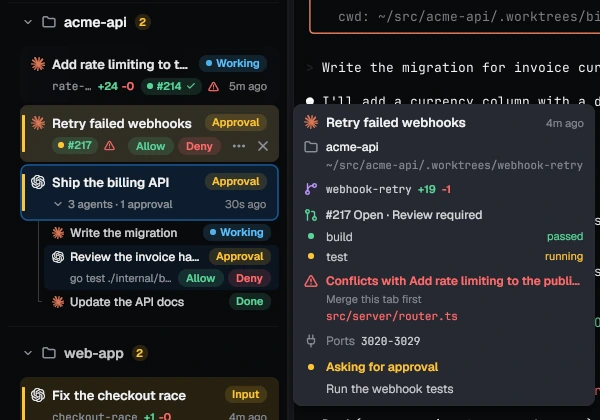

### Find where agents waste time and tokens

**Settings, Agent errors lists the failed commands, tool calls and API
errors your agents' hooks report, grouped by cause.** `zsh: command not found: rg` thirty-eight times
is one row, with its count and about how many tokens it cost. Sort by count
or by tokens, over 7 days, 30 days or all time. Copy report puts the list
on the clipboard as Markdown, so you can hand it to an agent and ask it to
fix the causes in CLAUDE.md, your shell config or a missing tool.

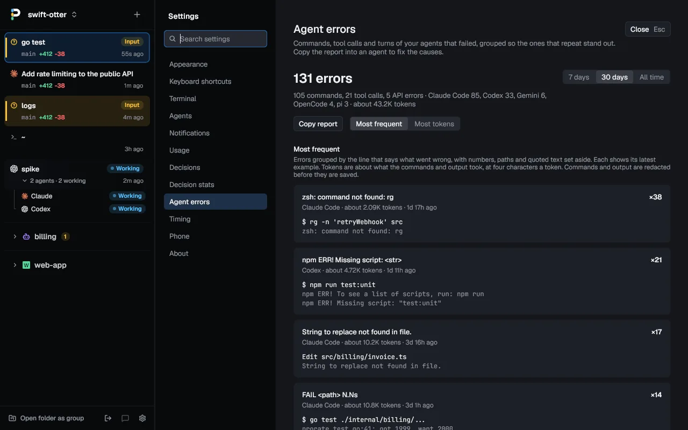

**Settings, Timing shows where your agents' time goes.** Each turn splits
into the model, tests, builds, CI, other tools and waiting on you, per day
and per task from prompt to merge, with the slowest commands. Copy report
hands that to an agent too. Both pages read logs the daemon keeps with
secrets redacted; the timing log holds no prompts or output.

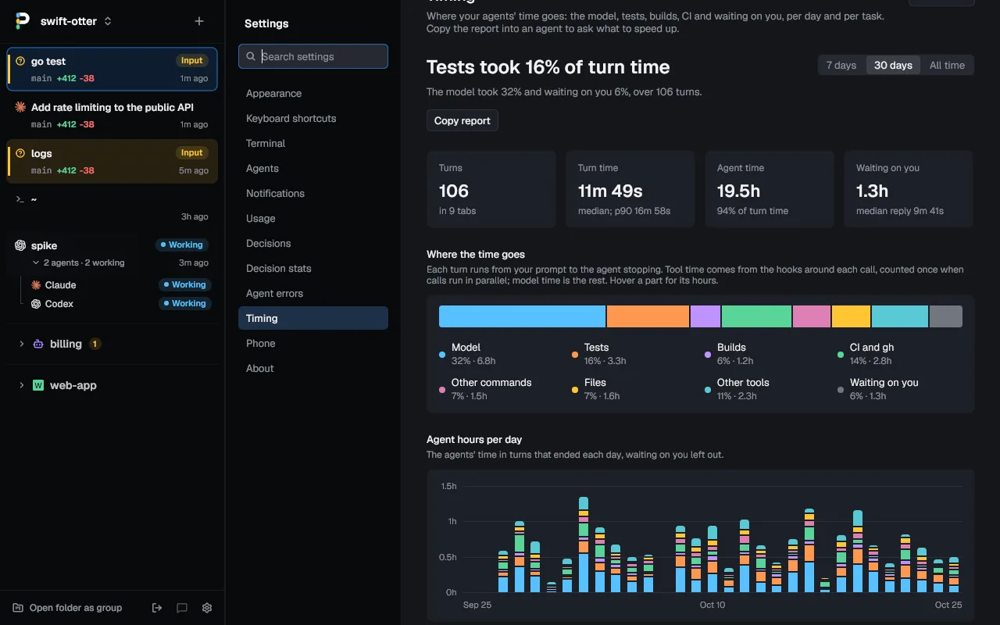

### Know what it costs

**See how much of your Claude Code and Codex plan limits you have used, and
when you will hit 100% at this pace.** The sidebar's footer keeps each
agent's fullest window in view. Settings, Usage also adds up what
the last 7, 30 or 90 days would cost at API prices, per agent and per day.
The agent panel shows each session's tokens and how full its context is,
and lists every subagent, Claude Code workflow runs included, with what it
was asked.

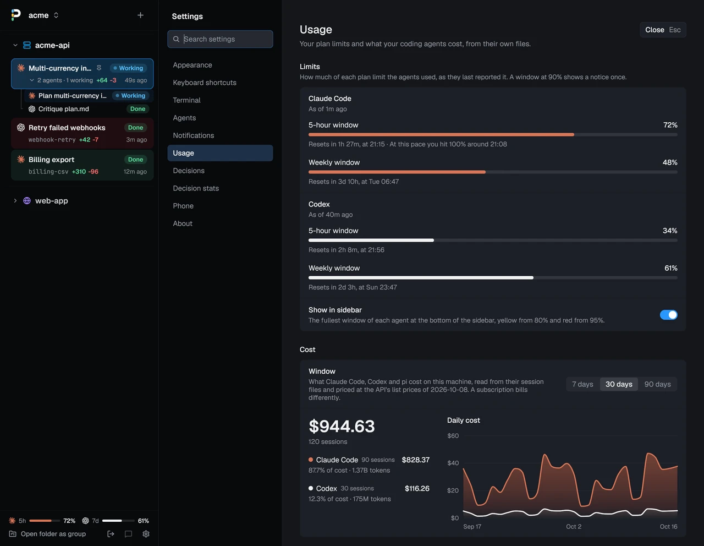

### Line up the next task

**New task (Ctrl+Shift+A) starts an agent on a prompt in a tab of its own,
or queues it until a running agent finishes.** Pick the project, a fresh
worktree or a branch, the agent and its permission mode. Cap how many
agents run at once, and the queue starts the next task as one finishes.

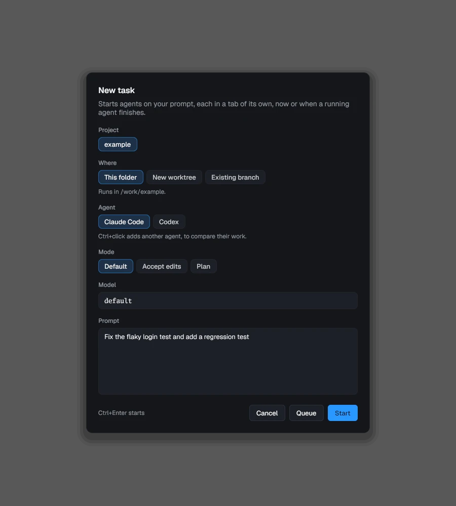

### Let one agent hand work to another

**An agent can open a tab with `pitwall new`, start Codex or Claude Code
in it on a prompt, and wait for the result with `pitwall wait`.** The tab
shows up in your sidebar, so you can watch the work and type into it. When
the new agent asks permission, `wait` stops and reports the question, and
you answer it in the tab. pitwall never answers for an agent. Hand
[the agent skill page](docs/agent-skill.md) to your agent and it knows the
commands.

Agents can also talk to each other. `pitwall send` types a message into
another agent at its next prompt, with a header saying who sent it and how
to reply, so Claude Code and Codex can argue over a plan until they agree.

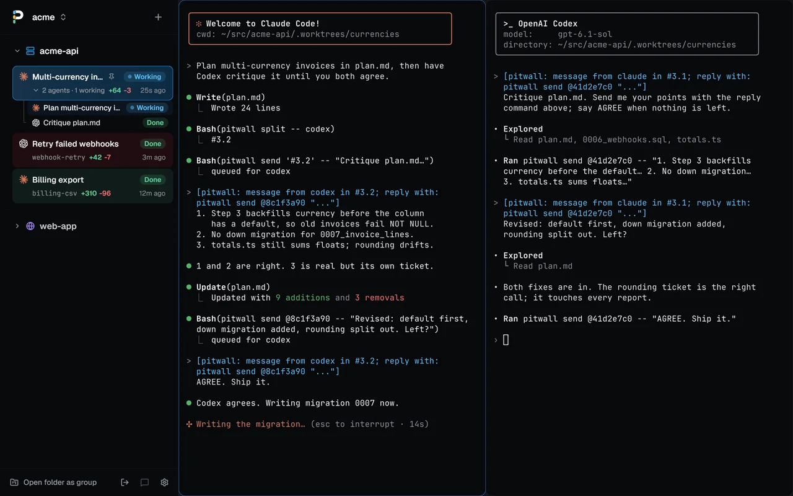

```sh
tab=$(pitwall new -n "review auth" -- codex "review origin/main..HEAD")
pitwall wait "$tab" --until done --timeout 20m

pane=$(pitwall split -- codex)
pitwall send "$pane" -- "Critique plan.md"
```

### Never lose a session

**Close the window, reboot or upgrade, and your tabs come back in their
folders with the agents resumed where they left off.** Sessions work like
tmux, and the switcher (Ctrl+Shift+S) shows every session's agents before
you switch. `pitwall --host box` runs them on another machine over ssh, so
they keep going when the laptop closes.

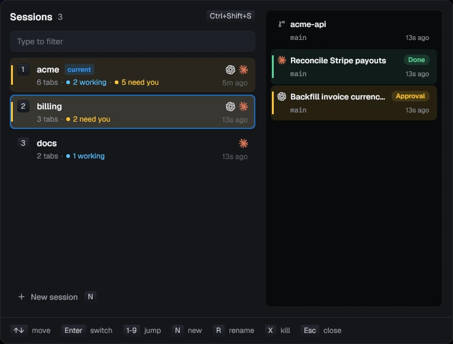

### Pin and color the tabs you keep

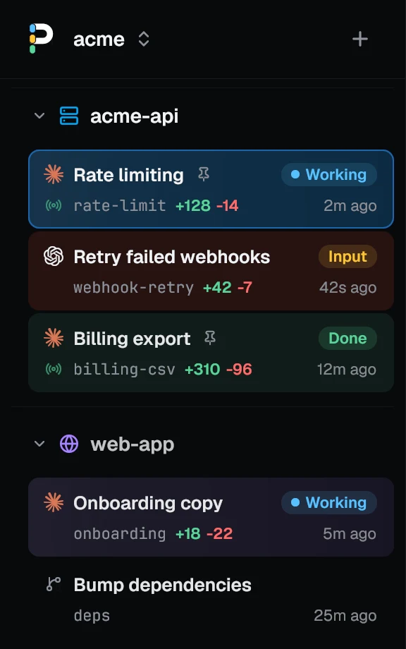

**Pin a tab and it stays open.** Closing it from the window asks you to
unpin it first, and `pitwall kill` from a script or another agent is
refused. Give a tab one of eight colors from its menu and its row takes a
faint tint, so the billing work and the webhook fix stop looking alike. A
soft green mark under the agent's icon shows which Claude Code sessions
have `/remote-control` on, so you know which ones you can pick up from your
phone.

<br clear="right">

### Drive it from the keyboard

**Ctrl+Shift+P lists every action with its keys.** Ctrl+Shift+F searches
the scrollback, copy mode (Ctrl+Shift+X) selects with vi keys, and a
selection stays on its text while new output scrolls past. Ctrl+Shift+H
moves focus to the sidebar, where the arrow keys walk the tabs and Enter
opens one. Search shortcuts by name or by the keys themselves, pick one of
four themes and your own fonts, and rebind any key in Settings or
`config.toml`.

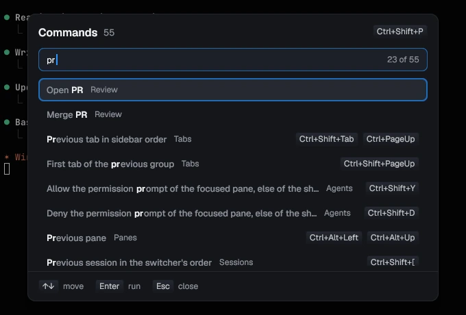

## Works with

| Agent       | What pitwall shows                                                   |
| ----------- | -------------------------------------------------------------------- |
| Claude Code | Every state, Allow and Deny, resume, side panel, cost, plan limits   |
| Codex       | Its state, Allow and Deny, resume, side panel, cost, plan limits     |
| Gemini CLI  | Every state but Error, resume, side panel, cost                      |
| OpenCode    | Working, Input, Approval, Done and Error, resume                     |
| pi          | Working, Done and Error, resume, side panel, cost                    |
| Oh My Pi    | Working, Done and Error, resume, side panel                          |
| Cursor CLI  | Working, Done and Error, resume                                      |
| Aider, Amp  | Aider's state read from its screen; Amp's logo, and its bell rings   |

Builds for Linux, macOS and Windows 10 and 11, on x86_64 and arm64.

## Keys

| Linux, Windows              | macOS                     | Does                                       |
| --------------------------- | ------------------------- | ------------------------------------------ |
| Ctrl+Shift+U                | Cmd+U                     | Go to the agent that needs you             |
| Ctrl+Shift+Y / Ctrl+Shift+D | Cmd+Shift+Y / Cmd+Shift+N | Allow / Deny the permission prompt         |
| Ctrl+Shift+R                | Cmd+Shift+R               | Review the tab's changes                   |
| Ctrl+Shift+A                | Cmd+Shift+A               | New task, now or queued                    |
| Ctrl+Shift+P                | Cmd+Shift+P               | Command palette: every action and its keys |
| Ctrl+Shift+T                | Cmd+T                     | New tab below this one, in its folder      |
| Ctrl+Shift+O / Ctrl+Shift+E | Cmd+D / Cmd+Shift+D       | Split the pane to the right / below        |
| Ctrl+Shift+S                | Cmd+S                     | Session switcher                           |
| Ctrl+Shift+L                | Cmd+L                     | Agent panel: the turn, subagents, plan     |

The aide preset puts these on Alt instead. [docs/keys.md](docs/keys.md) has
every binding, and all of them can be changed.

## For creators and press

Quantic Studios makes pitwall. We don't pay for coverage and don't expect
any. If you review it, say what you think, including what is broken.

**One line.** pitwall is a free desktop terminal that shows what each of
your coding agents is doing and takes you to the one waiting on you.

**One paragraph.** pitwall is a free, MIT-licensed desktop terminal for
running several coding agents at once. A sidebar shows each agent's state,
and one key jumps to the agent stuck on a question or a permission prompt.

**About 100 words.** pitwall is a free, MIT-licensed desktop terminal for
Linux, macOS and Windows, built for running several coding agents at once.
Each tab's row in the sidebar says whether its agent is working, waiting for
input or approval, done or failed. When one stops to ask, Ctrl+Shift+U
jumps to it, and Allow and Deny work from the sidebar or a paired phone. An
agent can split a job across workers, each in its own git worktree, and the
fleet shows as one row. A review view sends line comments back to the
agent. It works with Claude Code, Codex, OpenCode, Gemini CLI, Cursor CLI,
pi and Oh My Pi.

- Logo: [packaging/pitwall.svg](packaging/pitwall.svg)
- Screenshots and clips: [docs/media](docs/media)
- Contact: [info@quanticstudios.io](mailto:info@quanticstudios.io)

## Docs

- [Concepts](docs/concepts.md): session, tab, pane, group, worker and the agent states, and the [glossary](GLOSSARY.md)
- [Using pitwall](docs/usage.md): first run, watching agents, sessions, review, worktrees, tasks
- [Keybindings](docs/keys.md): the presets, tab mode, pane mode, find, copy mode, moving between vim and panes
- [Command line](docs/cli.md): every command, and driving tabs from scripts
- [Configuration](docs/config.md): config.toml, themes, fonts
- [Hooks](docs/hooks.md): what `pitwall hooks install` changes for each agent
- [Remote hosts](docs/remote.md): agents on another machine over ssh
- [Phone](docs/phone.md): pairing, push notifications, what the page sends
- [Decisions (Jev)](docs/decisions.md): approval advice, triage, turn checks, Decision stats
- [Where things live](docs/state.md): files, saved tabs, reboots, upgrades
- [Install](docs/install.md): platforms, updates, building from source
- [Troubleshooting](docs/troubleshooting.md): what to check, and the logs
- [Agent skill](docs/agent-skill.md): a page to hand an agent that drives pitwall
- [For agents](docs/llms.txt): what an agent reads first, inside pitwall, setting it up, or changing it
- [Development](docs/development.md) and [credits](docs/credits.md)

## Contributing

Read [CONTRIBUTING.md](CONTRIBUTING.md) before you send a pull request. Report
bugs with the [issue templates](https://github.com/quanticstudios/pitwall/issues/new/choose),
and vulnerabilities privately as [SECURITY.md](SECURITY.md) describes.

## License

MIT, see [LICENSE](LICENSE).
