# pitwall
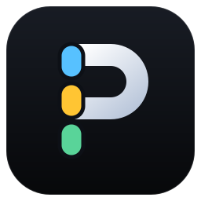

pitwall is a desktop terminal for running several coding agents at once,
with a sidebar that shows what each one is doing right now.

Run five agents in five tabs and sooner or later one stops to wait on you, on
a permission prompt or a question you have not seen. pitwall lights up that
tab, notifies you, and takes you there with one key.

- Free and open source, under the MIT license. No account.
- A desktop app for Linux, macOS and Windows, on x86_64 and arm64.
- Works with Claude Code, Codex, OpenCode, Gemini CLI, Cursor CLI, pi and
  Oh My Pi.
- Installs with one command.

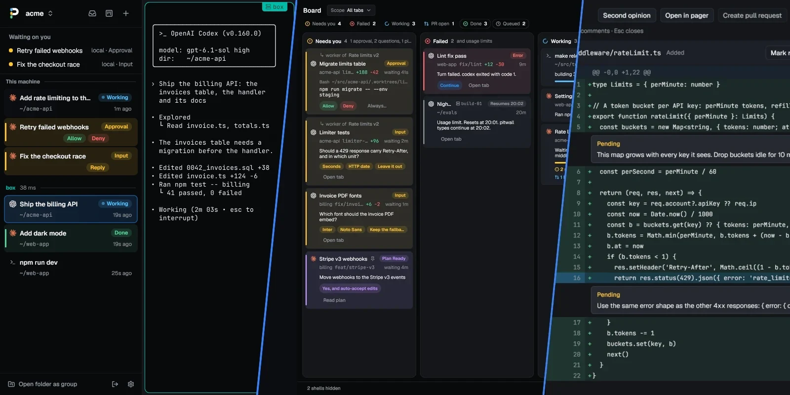

## Install

```sh
brew install quanticstudios/tap/pitwall   # macOS or Linux, with Homebrew
curl -fsSL https://raw.githubusercontent.com/quanticstudios/pitwall/main/scripts/get.sh | sh   # or the script
```

```powershell
scoop bucket add quanticstudios https://github.com/quanticstudios/scoop-bucket
scoop install pitwall                     # Windows, with Scoop
irm https://raw.githubusercontent.com/quanticstudios/pitwall/main/scripts/get.ps1 | iex   # or the script
```

Then run `pitwall`. `get.sh` installs it in `~/.local/bin`, so if your shell
can't find it, add that folder to your `PATH` or run `~/.local/bin/pitwall`. The
first window lists the agents on your `PATH` and sets up their status reporting
with one button. `pitwall doctor` checks the install and says what to fix.
pitwall runs every day on Linux; the macOS and Windows builds are newer and have
had little use. When a release is out, an Update button installs it on a script
install, and your tabs and config carry over; with Homebrew or Scoop, use
`brew upgrade` or `scoop update pitwall`. [docs/install.md](docs/install.md)
covers platforms, pinning a version, updates and building from source.

## Try it

Use a git repo you don't mind agents changing. On macOS the keys below
are Cmd+U, Cmd+Shift+Y, Cmd+Shift+N, Cmd+Shift+R and Cmd+T.

1. **Start two or three agents.** Run `pitwall` in the repo and press
   Install hooks on the welcome card (or in Settings, Agents), so the
   agents report their state.
   Ctrl+Shift+T opens a tab; run `claude` in one, `codex` in another, and
   give each a task that runs a command. In Codex, run `/hooks` once to trust
   the new hooks.
2. **Watch the sidebar.** Each tab's row reads Working, Input, Approval,
   Plan, Done or Error, with the branch and the lines changed.
3. **Press Ctrl+Shift+U.** When an agent stops to ask, its row lights up
   and a desktop notification arrives. The key takes you to the agent that
   started waiting most recently; press it again for the next one.
4. **Answer from the row.** A Claude Code or Codex permission prompt puts
   Allow and Deny on the row. Click them, or press Ctrl+Shift+Y or
   Ctrl+Shift+D. A Claude Code question pitwall recognizes in full puts its
   options there; otherwise the row offers Open tab or Reply. To answer from a
   phone, turn it on in Settings, Phone and give it an address the phone can
   reach, as [docs/phone.md](docs/phone.md) shows with Tailscale, since by
   default only your computer can reach it. Then press Pair and scan the QR code.
5. **Ask for a fleet.** Tell Claude Code or Codex "split this across three
   workers". Each worker gets its own worktree and tab, and a small row under
   the orchestrator's. Click the count on that row to fold them away.
6. **Review and comment.** Ctrl+Shift+R opens the tab's changes. Click a
   line number, type a comment and press Enter. The Send comments button
   types them all into the agent as one prompt.

## What you get

### See every agent at a glance

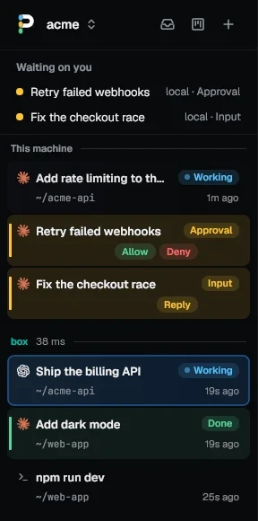

**Every tab's row says what its agent is doing: Working, Input, Approval,
Plan, Done or Error.** A tab with three agents in split panes lists each on
its own line. The row also shows the branch, the lines changed, and the pull
request with its CI and review. Merge it from the tab's menu; once merged,
Archive closes the tab and removes its worktree and branch.

**The inbox view sorts agents by what they need from you.** The button left
of + in the sidebar's header switches to it: Pinned, Waiting on you, Working,
Snoozed, Settled, then shells. Snooze a tab until later, and an approval,
question, plan or failure wakes it early. A tab settles when its pull request
merges or after three days without agent activity.

### Get to the one that needs you

**Ctrl+Shift+U jumps to the agent that started waiting most recently, in any
session.** Its pane gets a ring in the state's color and you get a desktop
notification. Press the key again for the next one. Any command can ask
too: `npm test && pitwall notify "tests passed"`.

**Ctrl+Shift+K finds any tab,** in every session and on every host the window
shows, by name, branch, folder, agent, pull request or first prompt. It lists
the tabs you closed too, up to 200 from the last 30 days, and reopens one with
its agent resumed.

<br clear="right">

### Answer without switching windows

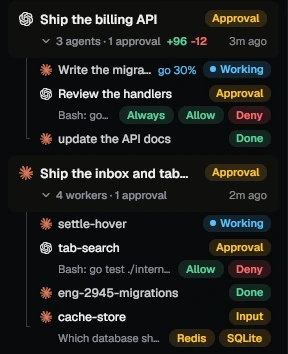

**Answer a prompt from its row, without opening the tab.** A Claude Code or
Codex permission prompt shows Allow and Deny, plus Always when the prompt has
one clear option to stop asking. When pitwall recognizes a whole Claude Code
form on screen, a single-choice question shows its options as buttons, and a
plan that offers manual approval shows Approve plan, which never raises the
permission mode. Otherwise the row offers Open tab, or Reply for a question with
no menu. An option, Always or Approve plan presses only if the screen still
offers it. Allow and Deny check that the row is current and a permission prompt
is on screen, not that the command is unchanged, so read it first.
Ctrl+Shift+Y and Ctrl+Shift+D press them, and on Linux the notification has
them too.

<br clear="right">

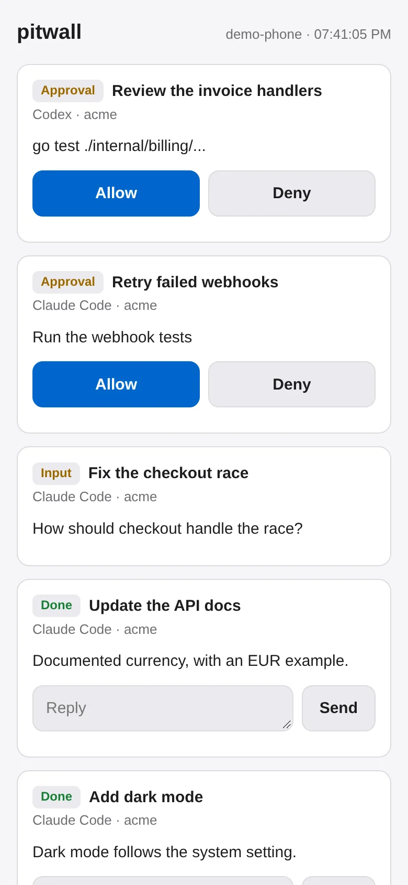

**Or answer from your phone.** Pair it by QR code and it lists what needs you,
with Allow and Deny and a box for typed answers. A menu on an agent's screen
takes no typed reply, so answer that one in its tab or from the sidebar. There
is no account and no relay: the phone talks to your computer over your own
network. [Push notifications](docs/phone.md#notifications) need separate setup:
a certificate the phone trusts, Turn on on the page, and on an iPhone the Home
Screen. They go through the browser's push service, encrypted.

<br clear="right">

### Run a fleet of workers

**Ask Claude Code or Codex to split a job and it starts one worker per
task, each in its own worktree, under its own tab.** Each worker gets a
small row under the orchestrator's, with its state and Allow and Deny when
it asks. The orchestrator's row counts them, as in "3 workers · 1
approval", and takes the most urgent state among them. Click the count to
fold them away; a worker that asks for you stays. Click a worker's row to
watch or type into it.

The orchestrator waits with `pitwall wait --children`. It stops at the
first worker that asks a question, and Ctrl+Shift+U takes you to it. When a
worker's pull request merges, Archive removes its tab, worktree and branch.

```sh
pitwall worktree new invoice-pdf -- claude "Render invoices as PDFs"
pitwall worktree new webhook-retry -- codex "Retry failed webhooks"
pitwall wait --children --until done --timeout 30m
```

`pitwall hooks install` teaches both agents these commands, so "split this
across three workers" is all you have to say.

Settings, Appearance, Sidebar, Workers gives each worker a full row of its own
instead, behind a bar of their states on the orchestrator's row, as here:

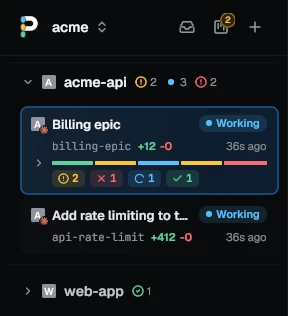 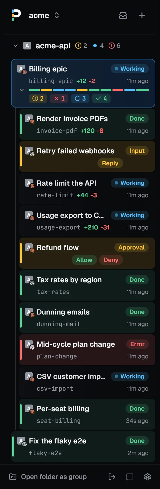

### Fleet mode

**Fleet mode sends each worker to a lane by the size of its task, and each
lane runs the model you picked for it.** A fast, cheap model takes the small
fixes and your strongest model takes the whole features, without anyone
picking a model per task. A lane runs one of your presets, which holds the
agent, model and effort.

On top of the lanes, pitwall keeps watch over the workers:

- Your worker contract, a text file on how to commit and when to stop, goes
  before every brief.
- A worker with no pull request open at its lane's timebox gets one nudge.
  At twice the timebox, the orchestrator hears about it.
- When a worker's checks fail again after pitwall sent it the failures twice
  (`auto_send_failures` under `[git]`), pitwall tells the orchestrator, or
  restarts the task on the big lane. [Fleet mode](docs/usage.md#fleet-mode)
  has the details.
- A finished worker reads **PR open** until its pull request merges or
  closes, and `pitwall wait --until done` keeps waiting for that.

Set it up in three steps:

1. In **Settings, Agents**, add a preset for each model: pick the agent, type
   the model, pick the effort.
2. In **Settings, Fleet**, pick a preset for the small, normal and big lanes,
   and turn fleet mode on.
3. Ask your orchestrator agent to split the work. It starts each worker on a
   lane:

```sh
pitwall worktree new login-fix --lane small -- "Fix the login redirect"
```

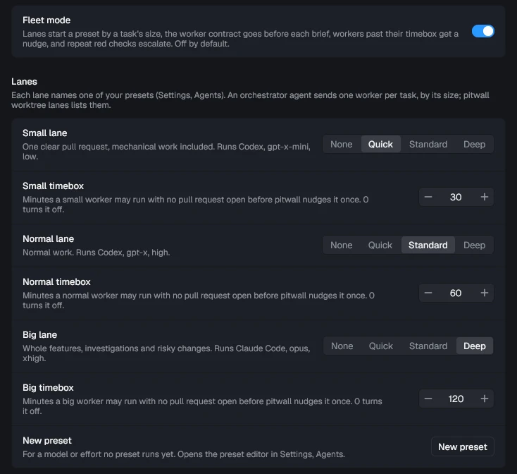

### Review what the agent changed

**Ctrl+Shift+R opens the tab's changes. Comment on any line, then send all
the comments to the agent as one prompt.** Untracked files are included.
Tick off the files you have read; one the agent touches again comes back
unticked. Throw away a file's changes with one button.

The This turn scope shows what changed since the agent's latest turn started,
and Undo turn puts those files back. The Staging scope stages single hunks with
s and u, so you can commit part of an agent's work; on a `pitwall --host` tab,
Stage hunks in terminal runs `git add -p` on the host. Second opinion starts
the other agent read only in a split to review the changes, and sends its
findings to the tab's agent.

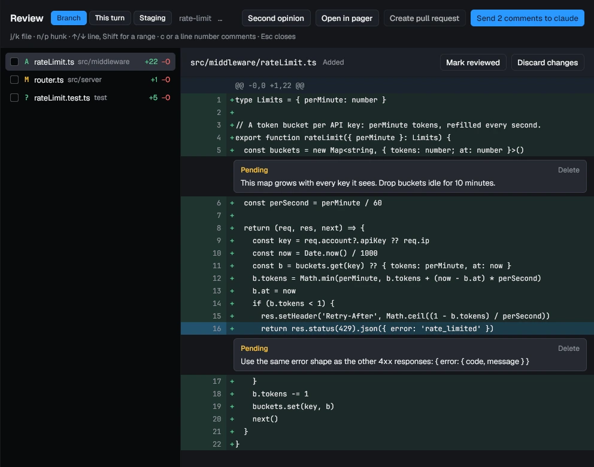

### Run agents side by side without collisions

**Give each agent its own git worktree, and pitwall warns you when their
changes collide.** Start one from any branch or a pull request number. Each
gets its own port block (3010-3019, then 3020-3029) in `PORT` and two more
variables, and a dev server that uses them stops fighting over 3000. Vite and
Astro need [a config line or a flag](docs/usage.md#worktree-ports-and-setup). A
worktree can also copy `.env` and run your setup command. Once one of
two branches has an open pull request, a row gets an amber triangle when they
touch the same files and a red one when merging would conflict. The hover card
lists every overlap and says which to merge first.

**Fork a conversation to try a second approach.** Fork in a tab's menu, or
`pitwall fork --worktree side`, continues a Claude Code or Codex conversation
in a new tab while the source keeps running. With `--worktree` the fork gets a
new branch from the source's HEAD, with its own ports and setup. Uncommitted
changes stay in the source checkout.

**Clean up what a worktree started.** Set `teardown`, such as
`docker compose down`, under `[worktrees]`, and it runs with the worktree's
ports before pitwall removes the folder. A failure keeps the worktree and says
why. A command from a repo's `.pitwall/worktree.toml` needs your yes each time,
since anyone can put code in a repo you clone. Without a yes, pitwall skips it,
shows what it would have run and removes the worktree.
`pitwall worktree rm --force` skips teardown.
[Worktree ports and setup](docs/usage.md#worktree-ports-and-setup) has the rules.

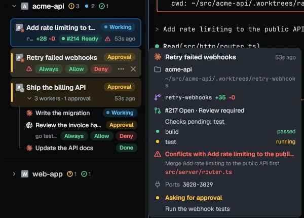

### Limit what an agent can do by accident

**`--guard` makes Claude Code, Codex, pi, Oh My Pi and OpenCode 1 refuse
commands that are yours to run,** such as `git push`, `gh pr merge` and
`terraform apply`, with a reason the agent reads. Turn it on for a tab with
`pitwall new --guard`, in a preset, or for every worker with `guard_workers`.
It reads the command's text, so a script that pushes gets through. It is a
seatbelt, not a sandbox.

**pitwall's own git turns off programs a repository's config names.** An agent
can write `.git/config`, and pitwall runs git by itself for branch stats,
checkpoints and worktrees. So it reads the config just before each git command
and turns off hooks, `core.fsmonitor`, and the diff, filter, merge, ssh and
credential programs set there. A program added in the moment between the two
can still run, so this reduces the risk and is not a sandbox boundary. It does
not contain an agent, which can already run any program as you when it has no
sandbox or approval prompt.
[What it turns off](docs/usage.md#what-a-repositorys-git-config-can-run) covers
the exceptions and side effects: git-crypt, `post-checkout` hooks, and the actions
that open a pane, which are your own git.

### Find where agents waste time and tokens

**Settings, Agent errors lists the failed commands, tool calls and API
errors your agents' hooks report, grouped by cause.** `zsh: command not found: rg` thirty-eight times
is one row, with its count and about how many tokens it cost. Sort by count
or by tokens, over 7 days, 30 days or all time. Copy report puts the list
on the clipboard as Markdown, so you can hand it to an agent and ask it to
fix the causes in CLAUDE.md, your shell config or a missing tool.

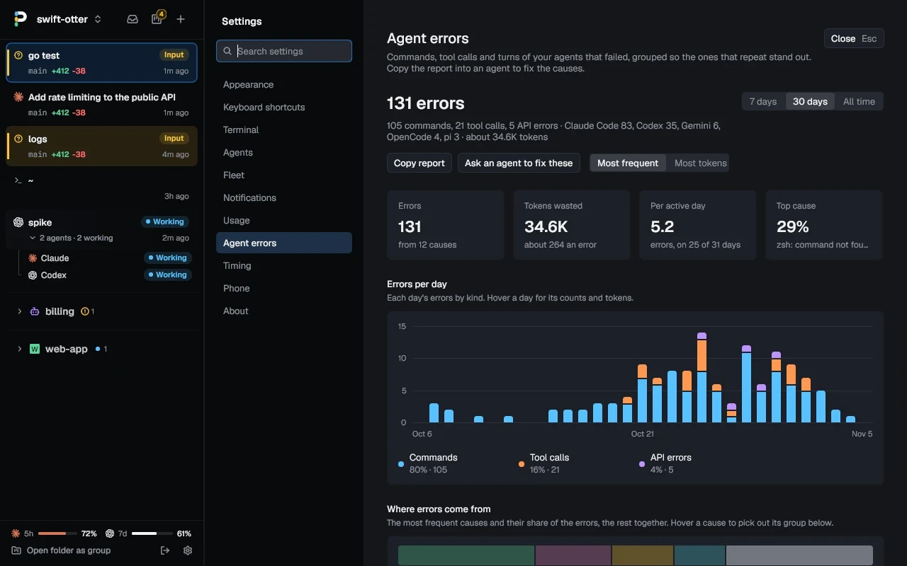

**Settings, Timing shows where your agents' time goes.** Each turn splits
into the model, tests, builds, CI, other tools and waiting on you, per day
and per task from prompt to merge, with the slowest commands. Copy report
hands that to an agent too. Both pages read logs the daemon keeps with
secrets redacted; the timing log holds no prompts or output.

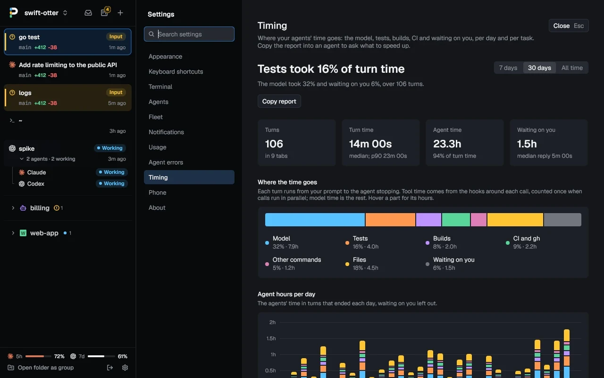

### Know what it costs

**See how much of your Claude Code and Codex plan limits you have used, and
when you will hit 100% at this pace.** The sidebar's footer keeps each
agent's fullest window in view. Settings, Usage also adds up what
the last 7, 30 or 90 days would cost at API prices, per agent and per day.
The agent panel shows each session's tokens and how full its context is,
and lists every subagent, Claude Code workflow runs included, with what it
was asked.

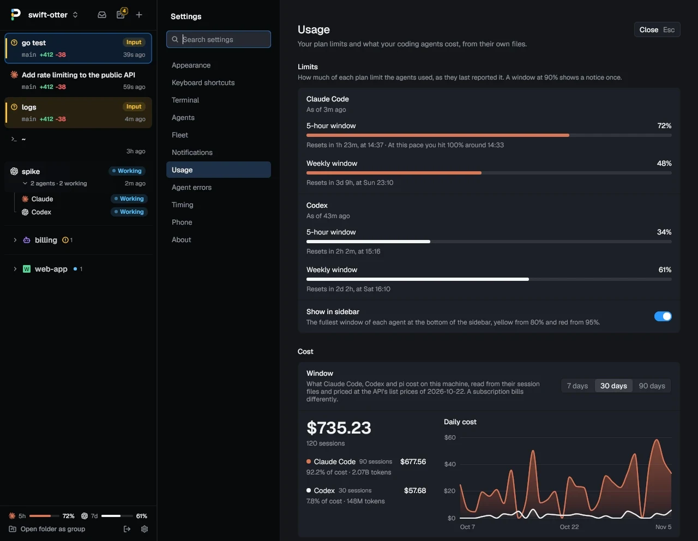

### Line up the next task

**New task (Ctrl+Shift+A) starts an agent on a prompt in a tab of its own,
or queues it until a running agent finishes.** Pick the project, a fresh
worktree or a branch, the agent and its permission mode. A task can start from
an open GitHub issue, at a set time or on a repeat. Cap how many agents run at
once, and the queue starts the next task as one finishes.

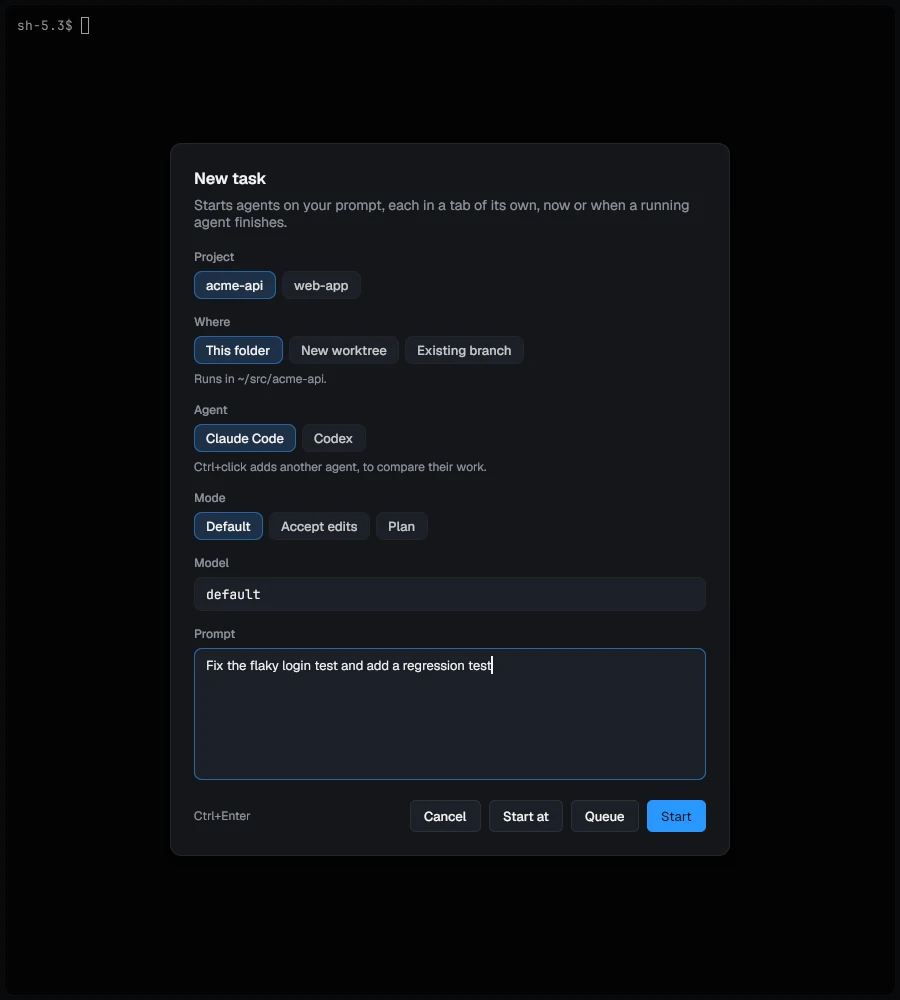

### Let one agent hand work to another

**An agent can open a tab with `pitwall new`, start Codex or Claude Code
in it on a prompt, and wait for the result with `pitwall wait`.** The tab
shows up in your sidebar, so you can watch the work and type into it. When
the new agent asks permission, `wait` stops and reports the question, and
you answer it in the tab or from its row. pitwall never approves a terminal
agent's permission prompt by itself.
Hand
[the agent skill page](docs/agent-skill.md) to your agent and it knows the
commands.

Agents can also talk to each other. `pitwall send` types a message into
another agent at its next prompt, with a header saying who sent it and how
to reply, so Claude Code and Codex can argue over a plan until they agree.

**Nothing pitwall types lands in your draft.** `pitwall send`, review comments,
sent CI failures and Reply wait while Claude Code's or Codex's input box holds
your text or you typed in the pane in the last 3 seconds. The row reads "Waits:
your draft". Send or clear the draft and they go in by themselves.

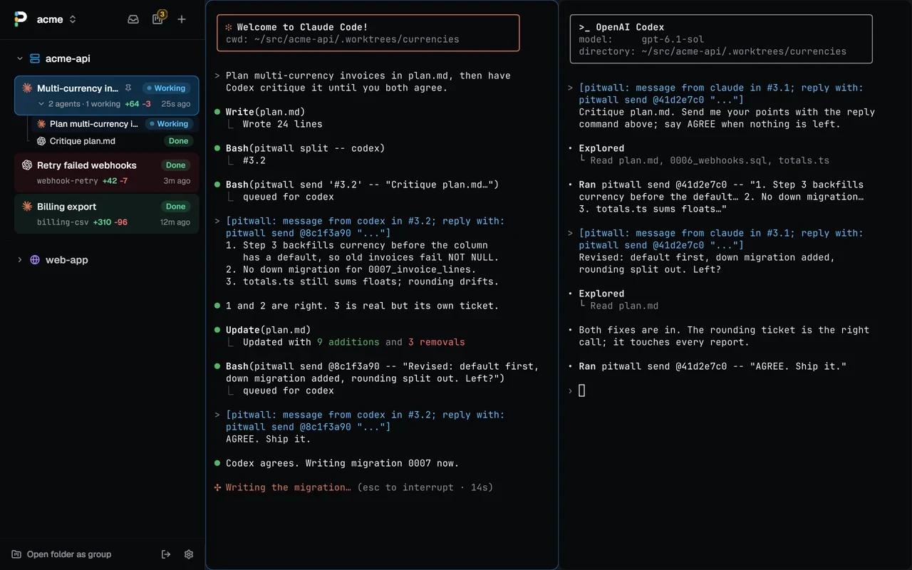

```sh
tab=$(pitwall new -n "review auth" -- codex "review origin/main..HEAD")
pitwall wait "$tab" --until done --timeout 20m

pane=$(pitwall split -- codex)
pitwall send "$pane" -- "Critique plan.md"
```

### Never lose a session

**Close the window, reboot or upgrade, and your tabs come back in their
folders with the agents resumed where they left off.** Sessions work like
tmux, and the switcher (Ctrl+Shift+S) shows every session's agents before
you switch. Panes keep their most recent 2000 rows across restarts, except in
guarded tabs.
`pitwall --host box` runs them on another machine over ssh, so they keep going
when the laptop closes. With `window = true` under `[[hosts]]`, one window shows
this machine's sessions and that host's under their own headings, with a Waiting
on you list of the agents blocked on any of them.

**Keep awake,** off by default, in Settings, Agents, holds a logind sleep block
on Linux and prevents idle sleep on macOS while any agent is Working and for a
grace period after, 15 minutes unless you change it. The screen can still sleep,
a closed lid or a suspend that ignores the block can still suspend Linux, and a
Mac still sleeps when you tell it to. Windows does nothing.

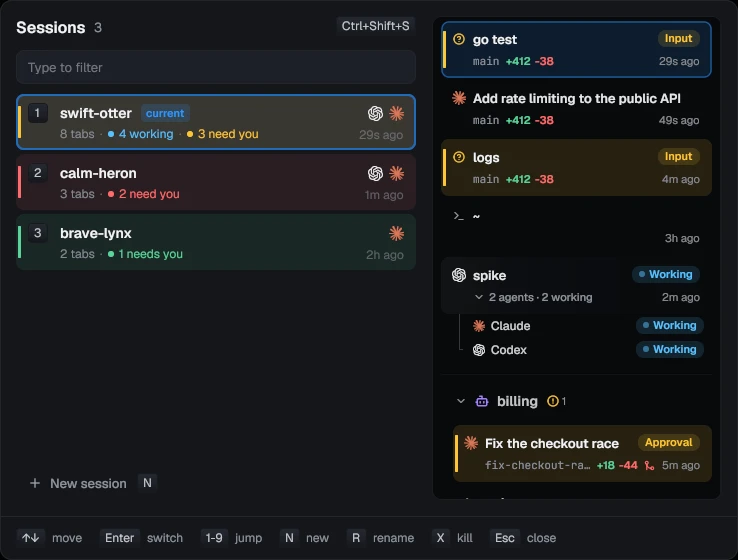

### Pin and color the tabs you keep

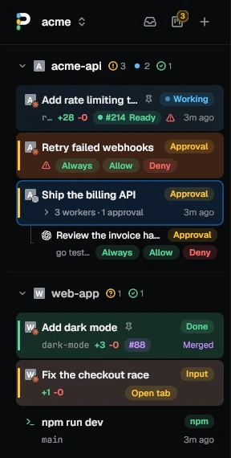

**Pin a tab and it stays open.** Closing it from the window asks you to
unpin it first, and `pitwall kill` from a script or another agent is
refused. Give a tab one of eight colors from its menu and its row takes a
faint tint, so the billing work and the webhook fix stop looking alike. A
soft green mark under the agent's icon shows which Claude Code sessions
have `/remote-control` on, so you know which ones you can pick up from your
phone.

<br clear="right">

### Drive it from the keyboard

**Ctrl+Shift+P lists every action with its keys.** Ctrl+Shift+F searches
the scrollback, copy mode (Ctrl+Shift+X) selects with vi keys, and a
selection stays on its text while new output scrolls past. Ctrl+Shift+H
moves focus to the sidebar, where the arrow keys walk the tabs and Enter
opens one. Pick one of five themes and your own fonts, and rebind any key in
Settings or `config.toml`.

**Ctrl+Shift+I types file paths into a prompt,** from a picker over the pane's
folder. Ctrl+Shift+G labels every URL, path, hash and `#number` on screen; type
a label to copy it, or Shift and the label to open it. With `open_path` under
`[terminal]`, such as `["bat", "--paging=always"]`, a path opens in a popup
over the panes. Picture in picture, in a tab's menu, keeps one pane live in a
corner while you work in another tab.

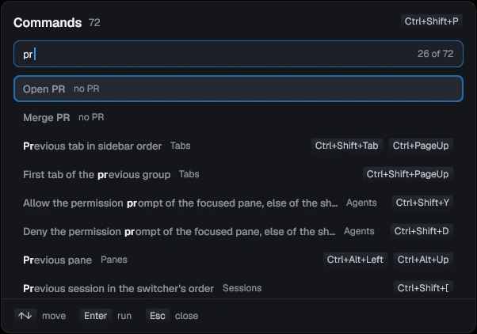

## Works with

| Agent       | What pitwall shows                                                   |
| ----------- | -------------------------------------------------------------------- |
| Claude Code | Every state, Allow, Deny and Always, question buttons, Approve plan, fork, resume, side panel, cost, plan limits |
| Codex       | Its state, Allow, Deny and Always, fork, resume, side panel, cost, plan limits |
| Gemini CLI  | Every state but Error, resume, side panel, cost                      |
| OpenCode    | Working, Input, Approval, Done and Error, resume; [managed driver](internal/session/opencode/README.md) |
| pi          | Working, Done and Error, resume, side panel, cost                    |
| Oh My Pi    | Working, Done and Error, resume, side panel                          |
| Cursor CLI  | Working, Done and Error, resume                                      |
| Aider, Amp  | Aider's state read from its screen; Amp's logo, and its bell rings   |

Builds for Linux with glibc 2.35 or newer, macOS, and Windows 10 1809 or newer
and 11, on x86_64 and arm64.

## Keys

| Linux, Windows              | macOS                     | Does                                       |
| --------------------------- | ------------------------- | ------------------------------------------ |
| Ctrl+Shift+U                | Cmd+U                     | Go to the agent that needs you             |
| Ctrl+Shift+Y / Ctrl+Shift+D | Cmd+Shift+Y / Cmd+Shift+N | Allow / Deny the permission prompt         |
| Ctrl+Shift+R                | Cmd+Shift+R               | Review the tab's changes                   |
| Ctrl+Shift+A                | Cmd+Shift+A               | New task, now or queued                    |
| Ctrl+Shift+P                | Cmd+Shift+P               | Command palette: every action and its keys |
| Ctrl+Shift+K                | Cmd+K                     | Search tabs, open and closed               |
| Ctrl+Shift+I                | Cmd+Shift+I               | Insert file paths at the cursor            |
| Ctrl+Shift+G                | Cmd+Shift+G               | Hints: copy or open what's on screen       |
| Ctrl+Shift+T                | Cmd+T                     | New tab below this one, in its folder      |
| Ctrl+Shift+O / Ctrl+Shift+E | Cmd+D / Cmd+Shift+D       | Split the pane to the right / below        |
| Ctrl+Shift+S                | Cmd+S                     | Session switcher                           |
| Ctrl+Shift+L                | Cmd+L                     | Agent panel: the turn, subagents, plan     |

The aide preset moves the tab, pane, session and go-to keys to Alt.
[docs/keys.md](docs/keys.md) has every binding, and all of them can be changed.

## For creators and press

Quantic Studios makes pitwall. We don't pay for coverage and don't expect
any. If you review it, say what you think, including what is broken.

**One line.** pitwall is a free desktop terminal that shows what each of
your coding agents is doing and takes you to the one waiting on you.

**One paragraph.** pitwall is a free, MIT-licensed desktop terminal for
running several coding agents at once. A sidebar shows each agent's state,
and one key jumps to the agent stuck on a question or a permission prompt.

**About 100 words.** pitwall is a free, MIT-licensed desktop terminal for
Linux, macOS and Windows, built for running several coding agents at once.
Each tab's row in the sidebar says whether its agent is working, waiting for
input or approval, done or failed. When one stops to ask, Ctrl+Shift+U
jumps to it, and Allow and Deny work from the sidebar or a paired phone. An
agent can split a job across workers, each in its own git worktree, listed
under its row. A review view sends line comments back to the
agent. It works with Claude Code, Codex, OpenCode, Gemini CLI, Cursor CLI,
pi and Oh My Pi.

- Logo: [packaging/pitwall.svg](packaging/pitwall.svg)
- Screenshots and clips: [docs/media](docs/media)
- Contact: [info@quanticstudios.io](mailto:info@quanticstudios.io)

## Docs

- [Concepts](docs/concepts.md): session, tab, pane, group, worker and the agent states, and the [glossary](GLOSSARY.md)
- [Using pitwall](docs/usage.md): first run, watching agents, sessions, review, worktrees, tasks
- [Keybindings](docs/keys.md): the presets, tab mode, pane mode, find, copy mode, moving between vim and panes
- [Command line](docs/cli.md): every command, and driving tabs from scripts
- [Configuration](docs/config.md): config.toml, themes, fonts
- [Hooks](docs/hooks.md): what `pitwall hooks install` changes for each agent
- [Remote hosts](docs/remote.md): agents on another machine over ssh
- [Phone](docs/phone.md): pairing, push notifications, what the page sends
- [Decisions (Jev)](docs/decisions.md): approval advice, triage, turn checks, Decision stats
- [Where things live](docs/state.md): files, saved tabs, reboots, upgrades
- [Install](docs/install.md): platforms, updates, building from source
- [Troubleshooting](docs/troubleshooting.md): what to check, and the logs
- [Agent skill](docs/agent-skill.md): a page to hand an agent that drives pitwall
- [For agents](docs/llms.txt): what an agent reads first, inside pitwall, setting it up, or changing it
- [Development](docs/development.md) and [credits](docs/credits.md)

## Contributing

Read [CONTRIBUTING.md](CONTRIBUTING.md) before you send a pull request. Report
bugs with the [issue templates](https://github.com/quanticstudios/pitwall/issues/new/choose),
and vulnerabilities privately as [SECURITY.md](SECURITY.md) describes.

## License

MIT, see [LICENSE](LICENSE).
