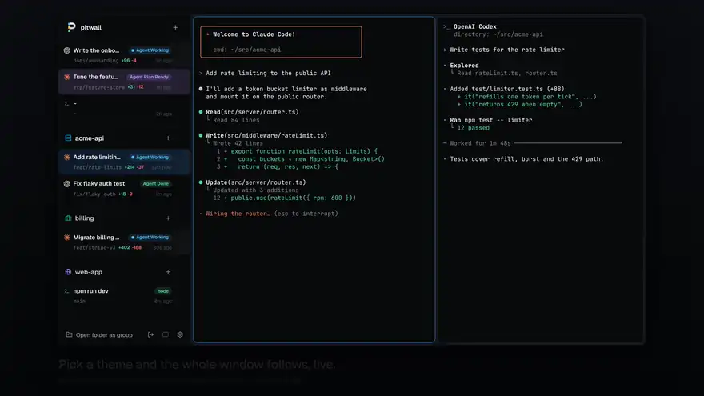
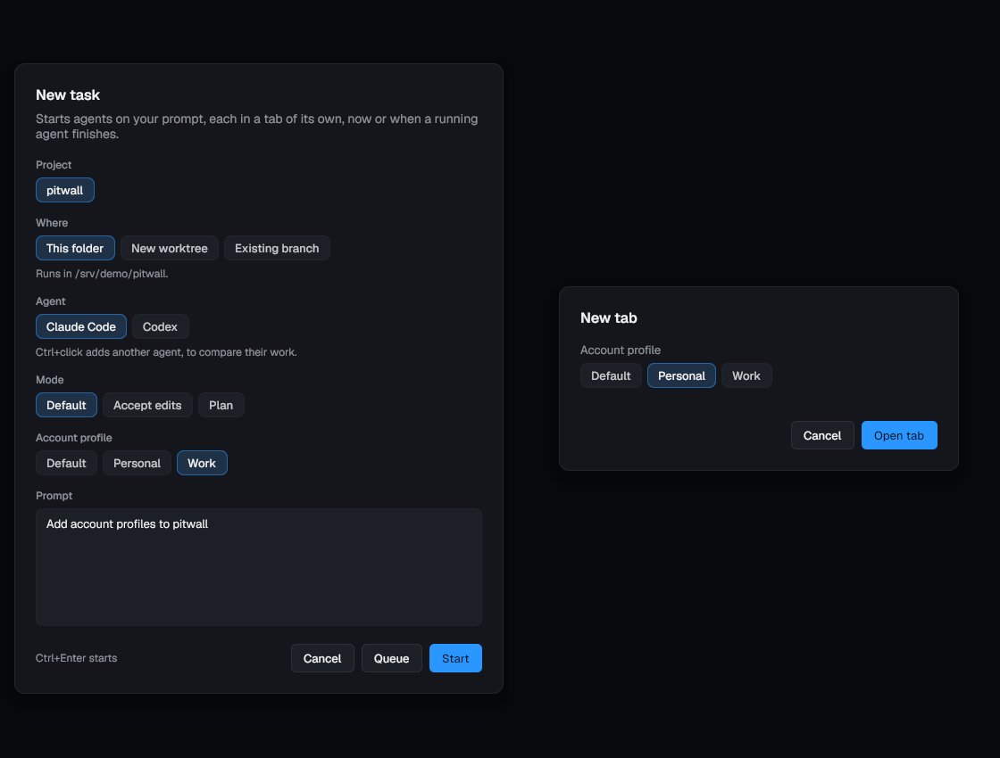
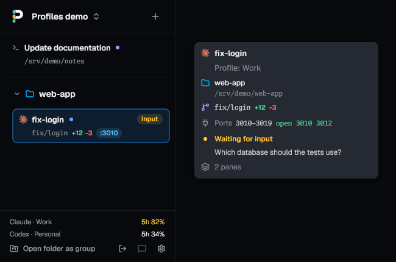
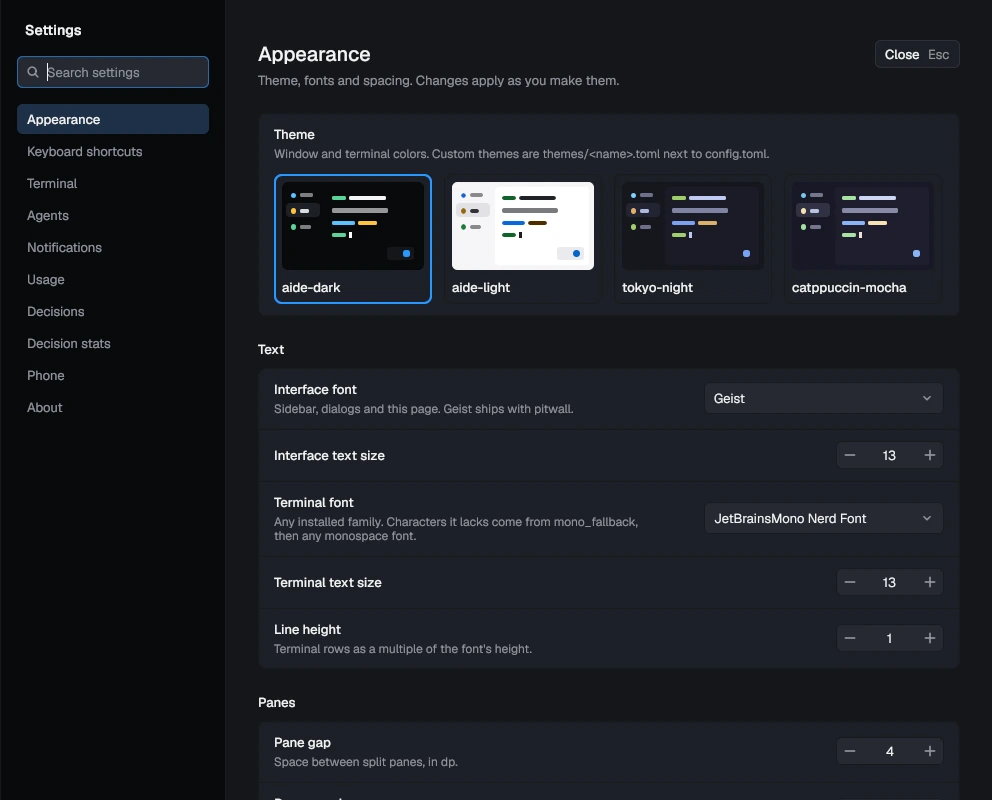

# Configuration



pitwall reads `~/.config/pitwall/config.toml` (`$XDG_CONFIG_HOME`). Without
the file everything has its default. An open window rereads the file within
a second of a change and applies keys, theme, fonts and spacing at once.
Mistakes show as a desktop notification; the window keeps running, and only
the broken entries fall back to their defaults.

| Command                  | Does                                                          |
| ------------------------ | ------------------------------------------------------------- |
| `pitwall config init`    | Write a commented config listing every option, and its schema |
| `pitwall config check`   | Print problems as `config.toml:LINE: message`; exit 1 if any  |
| `pitwall config default` | Print the commented config                                    |
| `pitwall config path`    | Print the config file's path                                  |
| `pitwall config schema`  | Print the JSON Schema (`schema theme` for theme files)        |

The file `init` writes starts with `#:schema ~/.config/pitwall/schema.json`,
so editors with taplo or Even Better TOML complete action names and flag a
bad chord, color or key as you type. The window refreshes the schema files
when a new pitwall knows more keys.

```toml
[keys]
preset = "conventional"
new_tab = ["Ctrl+Shift+T", "Super+T"]  # a chord or a list of chords
toggle_sidebar = "Ctrl+B"
tab_prefix = []                         # [] unbinds

[keys.tab]                              # tab mode, after tab_prefix
rename = "F2"

[keys.pane]                             # pane mode, after pane_prefix
fullscreen = ["F", "Z"]

[theme]
name = "tokyo-night"

[theme.colors]
primary = "#ff9e64"

[font]
mono_family = "Iosevka"
mono_size = 14
line_height = 1.1
mono_fallback = ["Noto Sans Mono CJK SC"]

[layout]
pane_gap = 4
pane_margin = 4

[git]
merge_method = "squash"                 # or "merge", "rebase": Merge PR's gh pr merge flag
archive_on_merge = false                # archive a merged worktree tab without a click
send_failures_on_fail = false           # send CI failures once per head commit
send_review_on_request = false          # send requested changes once per review
# auto_send_failures = false            # older name; send_failures_on_fail overrides it
conflict_radar = true                   # mark tabs whose branches change the same files

[[agents.preset]]                       # Settings, Agents adds and edits these
name = "Quick"
agent = "codex"
args = ["-m", "gpt-x", "-c", "model_reasoning_effort=low"]

[fleet]                                 # see usage.md, Fleet mode
enabled = false                         # pitwall worktree new --lane and the timeboxes
contract = ""                           # a file that goes before every --lane brief
escalate = "parent"                     # or "respawn", "off": CI red after two sends

[fleet.small]                           # also [fleet.normal] and [fleet.big]
preset = ""                             # an [[agents.preset]] name; empty is off
timebox = 30                            # minutes before one nudge; 60 and 120 for the others
```

Chords are modifiers (`Ctrl`, `Alt`, `Shift`, `Super`) and a key joined by
`+`, in any case. `Cmd` is another name for `Super`, which is the Command key
on macOS. Keys are a printable character, `Space`, `Tab`, `Enter`,
`Esc`, `Backspace`, `Delete`, `Home`, `End`, `PageUp`, `PageDown`, `Up`,
`Down`, `Left`, `Right` or `F1`-`F12`. Two actions on one chord is an error
naming both.

## Account profiles



Give work and personal accounts separate agent config directories. Each
`[profiles.<name>]` can set either or both directories, an optional label,
and a color for the tab row's small account mark:

```toml
[profiles.work]
label = "Work"
color = "#60a5fa"
claude_config_dir = "~/.claude-work"
codex_home = "~/.codex-work"

[profiles.personal]
label = "Personal"
color = "#c084fc"
claude_config_dir = "~/.claude-personal"
codex_home = "~/.codex-personal"
```

Use absolute paths or `~/path`. `claude_config_dir` sets
`CLAUDE_CONFIG_DIR`; `codex_home` sets `CODEX_HOME`. An omitted directory
leaves that agent's environment alone. Profile overrides win over preset
variables. The label defaults to the profile name and the color to the
theme's accent. Credentials stay in each agent's directory.

Sign in to each account with the agent's CLI first. For example:

```sh
CLAUDE_CONFIG_DIR="$HOME/.claude-work" claude
CODEX_HOME="$HOME/.codex-work" codex
```

Install pitwall's hooks in those directories. This explicit command also
sets up Claude Code's status line to report that account's limits:

```sh
CLAUDE_CONFIG_DIR="$HOME/.claude-work" CODEX_HOME="$HOME/.codex-work" pitwall hooks install --statusline
```

Repeat for each account. Codex asks you to trust its hooks with `/hooks`.
An existing Claude status line is wrapped and its output is preserved.

New task offers an Account profile choice, applied to each selected agent.
New tab asks for a profile when profiles are configured; its shell passes
the directories to agents you start in it. Choose Default to keep the
existing environment. With no configured profiles, tab creation behaves
as before. A tab's hover card shows its profile label, and new split panes
use the same directories.



Usage's Limits section and the optional sidebar limit display name each
profile separately. Claude limits come from that profile's status line;
Codex limits come from rollouts under its `codex_home`. Automatic continue
after a limit uses only the stopped tab's profile. Tabs save their profile
name and resolved directories across daemon restarts. Older state files
without a profile still load with the default environment. Removing a
profile leaves existing tabs' saved directories intact; its limits stop
being scanned until the profile is configured again.

## Themes



Built in: `aide-dark` (the default), `aide-light`, `tokyo-night`,
`catppuccin-mocha`. A custom theme is `~/.config/pitwall/themes/<name>.toml`
with the same keys as `[theme]`; its `name` picks the built-in it starts
from, so it only lists what differs. Add `#:schema
~/.config/pitwall/theme.schema.json` as its first line for completion.

| `[theme.colors]`    | Used for                                    |
| ------------------- | ------------------------------------------- |
| `bg`                | Window background                           |
| `sidebar`           | Sidebar background                          |
| `surface`           | Pane canvas, dialogs, cards                 |
| `surface_secondary` | Selected rows, active tab, fields           |
| `surface_elevated`  | Hovered and floating surfaces, badges       |
| `border`            | Hairlines                                   |
| `fg`                | Text                                        |
| `muted`             | Secondary text                              |
| `primary`           | Accent: buttons, focus, the tab-mode chip   |
| `on_primary`        | Text on primary buttons                     |
| `red`               | Errors                                      |
| `yellow`            | Waiting for you                             |
| `green`             | Done, idle                                  |
| `blue`              | Working                                     |
| `purple`            | Plan ready                                  |

`[theme.terminal]` has `foreground`, `background`, `cursor` and `ansi`, an
array of the 16 ANSI colors (black, red, green, yellow, blue, magenta, cyan,
white, then the bright ones). Colors are `#rrggbb` or `#rrggbbaa`. The
daemon answers programs' color queries (OSC 10, 11 and 4) from the terminal
colors; a running daemon picks a change up the next time it starts.

## Fonts and spacing

`[font]` takes `ui_family` (default the bundled Geist), `ui_size` (13),
`mono_family` (`JetBrainsMono Nerd Font`), `mono_size` (13), `line_height`
(a multiple of the font's, 1.0) and `mono_fallback`, families tried for
characters the terminal font lacks before any monospace font and color
emoji. Families are any installed font (`fc-list : family`); a missing one is
reported and the default is used. `[layout]` sets `pane_gap` and
`pane_margin` in dp (both 4). `ui_size` scales the sidebar, menus, the
command palette and dialogs as well as the settings page.

`[appearance]` has `reduce_motion` (default `false`). On, dialogs, menus,
hover cards, hover fills and the pane focus border change at once instead
of easing in over 80 to 200 ms. `remote_control` (default `true`) marks a
tab under its agent's icon while Claude Code's `/remote-control` is on for
it; off, pitwall stops reading Claude Code's session files.

The muted text color of every built-in theme reads at 4.5:1 or better on
its backgrounds. Status chips darken or lighten their text until it does,
so a custom theme's chips stay readable too.

## ACP agents

Use `[[agents.acp]]` for managed agents that speak ACP v1 over stdio. Each entry
sets `name`, `command`, `args` and `env`. See [ACP agents](acp.md) for configuration,
provider discovery and capability limits.
