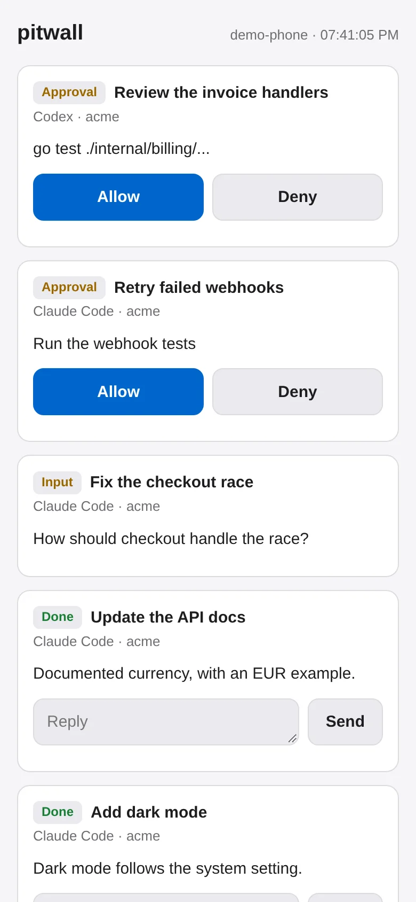
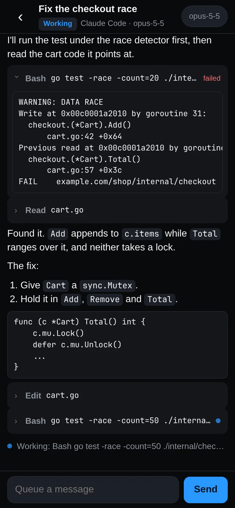

# Phone

pitwall can serve a page that puts your tabs on your phone: the list the
sidebar shows, and each agent's conversation as a chat you can read and
type into. It runs inside pitwall's background service and shows what that
service runs now, so tabs come and go on the phone as they do in the
window. There is no account and no relay, and the page needs no app: the
phone talks to your computer over your own network. An
[Android app](#android-app) shows the same, if you build it.

 

It is off until you turn it on in Settings, Phone, or in config.toml:

```toml
[remote]
enabled = true
```

By default it listens on `127.0.0.1:7777`, which only your computer can
reach. The way to get it onto your phone is your tailnet. With
[Tailscale](https://tailscale.com) on both devices:

```sh
tailscale serve --bg 7777
```

That prints an address such as `https://laptop.tail1234.ts.net`, with a
certificate Tailscale manages and reachable only from your own devices. Put
it in the config so the pairing code points there:

```toml
[remote]
enabled = true
url = "https://laptop.tail1234.ts.net"
```

An SSH tunnel works too: `ssh -L 7777:127.0.0.1:7777 your-computer` from a
phone SSH client, then open `http://127.0.0.1:7777`.

## Pair a phone

Run `pitwall remote pair`, or press Pair in Settings, Phone. It shows a QR
code and a URL holding a one-time code, good for 10 minutes. Scan it and the
page trades the code for a device token, which the phone keeps; pitwall keeps
only the token's SHA-256 under `remote/` in the state folder (mode 0600). A
request without a valid token gets nothing. After 10 failed codes or tokens
in a minute, every request is refused until the minute is up.

| Command                         | Does                                                                       |
| ------------------------------- | -------------------------------------------------------------------------- |
| `pitwall remote pair [name]`    | Pair a phone; prints the QR code and URL                                   |
| `pitwall remote devices`        | List paired devices                                                        |
| `pitwall remote revoke <name>`  | Unpair one by name or id; its token and its push subscription stop at once |

## The tab list

The page lists every tab of every session in the sidebar's order, under
its session's name and its group's. Each row shows the tab's name, its
state (Working, Approval, Input, Done, Error), its agent and branch, and
what the agent asks or said last. A tab that waits on you has a filled
row, and the page's title counts them. Detached tabs and Monitor tabs are
left out.

The page keeps one connection open to pitwall and gets the list again
whenever it changes, so a row moves as soon as the sidebar's does. When the
connection drops, a line says "Offline, reconnecting" and the page tries
again after 1 second, then 2, 4 and so on up to 15. Waking the phone
reconnects at once.

## A tab's chat

Tap a row to open its chat. pitwall reads the agent's own session file,
the one its hooks name: Claude Code's transcript, Codex's rollout or pi's
session. It follows the newest one, so the chat starts over after `/clear`,
a resume or a fork. The chat shows

- your prompts, on the right;
- the agent's replies, with paragraphs, lists, code blocks, inline code
  and links;
- each tool call as one line, its name and what it ran or read, which
  opens to the start of its output, and says "failed" when it failed;
- errors and interrupted turns, in red.

Thinking and the agent's own bookkeeping are left out. New entries arrive
as the agent writes them, a whole message at a time. While the agent works,
a "Working:" line under the chat names the call it runs. The chat stays at
its bottom while you are there; scrolled up, it shows a New messages button
instead of moving. Scrolling to the top loads earlier messages, as far back
as the last 8 MiB of the file.

A tab without a session file, a shell or an agent without hooks, shows its
state and never its screen or scrollback. The page never shows a pane's
screen.

## Send a message

Every agent tab has a box at the bottom. Claude Code and Codex receive a
message in their input box even during a turn, then decide when to read it.
Other agents receive it once their turn ends. A draft of yours, a form or
an approval holds the message in pitwall's queue. It goes in as a paste
followed by Enter, with control characters removed, so it cannot press keys
or end the paste. The message shows as Queued while pitwall holds it, then
as Sent once it goes in, until it shows up in the chat. While a tool of
the agent's holds the terminal, the message waits.
If the agent exits before the message goes in, pitwall drops it and the
page marks it "Not sent: the agent exited"; it never goes to the shell left
behind. A shell
tab has no box: pitwall never types into a shell from here.

A chat tab (one pitwall drives with `pitwall chat` rather than in a
terminal) shows its transcript the same way, and a message starts a turn or
queues behind the running one.

## Model and effort

A Claude Code tab has a button in its header with the model its latest
turn used. It offers the models `default`, `fable`, `opus`, `opus[1m]`,
`sonnet` and `haiku`, and the effort levels `low`, `medium`, `high`, `xhigh` and `max`.
A pick changes only that tab's Claude Code session, never the default
model or effort of new sessions. Typing `/model <name>` or `/effort <level>`
would save it as that default, so pitwall types `/model` or `/effort` alone,
moves Claude Code's picker or slider to your pick, checks the screen shows
it, and presses `s`, Claude Code's key for this session only. If the picker
has no row for the pick or the menu does not move to it, pitwall closes it
with Esc, which saves nothing, and the phone says why. A pick goes in only
while Claude Code sits at its input box: not during a turn, a question or a
form, and not over a draft. One pick goes in at a time, never while a
queued message is being typed, and the buttons wait for it. If you type in
that tab on the computer while a pick is under way, or its menu closes,
pitwall stops and presses nothing more. When Claude
Code asks "Switch model?" in a conversation, pitwall answers yes, since
your pick already did. Claude Code then reads the whole conversation again
on the new model.

The buttons show what the session runs, as Claude Code's screen reports it.
Your pick shows until the session reports a change, or for 5 seconds if it
never does, so a pick that did not apply and a change made on the computer
both show as they are.

Codex has no picker here: its `/model` opens a menu that pitwall cannot
drive safely.

## Approvals and questions

When the open tab waits on you, a card above the box says what for.
Allow presses the first option of the agent's prompt, Yes: `1` for Claude
Code and `y` for Codex. Deny presses Esc. Both actions require the card to
be current and a permission prompt to be on the screen. Deny does not
compare the command on that prompt.
The card keeps the tool and its full command or file. Long commands scroll
inside the card, and expanding a tool row shows every command line.
If pitwall cannot confirm the permission prompt, the card explains why and
offers Deny and Open on desktop. Open on desktop focuses an existing
pitwall window showing that session.
When the agent's hook reported a shell command, Allow requires the prompt
to show the complete command, including its lines and indentation. Claude
commands may contain tabs; Codex commands with tabs require an answer on
the desktop. Hidden or clipped command text prevents Allow;
[Usage](usage.md) has the details. A
plain-text question takes an answer through the composer. Other terminal
forms take no typed answer through the composer, since Enter would select
an option. Claude Code and Codex terminal questions appear inline in the
chat with 48 dp option buttons. MultiSelect questions have toggles and Submit. Other
takes a typed answer. Several questions advance one page at a time, then
show the agent's review or submit page. Each answer names the current page;
a changed page refuses an older tap. Always and Approve plan remain on
the sidebar. pi has no permission prompts.

A chat tab shows what its agent asks in full: the tool and its command or
file for an approval, the whole text of a plan, and each question of an
input request with its options. An approval takes Allow, Allow for session,
or Deny with an optional reason the agent reads. A plan takes Approve plan
or Keep planning. A question takes a tapped option or a typed answer. These
go to the chat as the GUI's answers do, by the request's id, so the first
answer from any client wins: one that comes later, from the phone, the GUI,
`pitwall chat approve` or aide, gets "no longer pending", and every client's
copy of the chat drops the request.

## Android app

The same tabs and chats also come as an Android app: pitwall's own
sidebar as the home screen, and each agent tab's chat with model, effort
and send on the message box. It talks to the phone page's API, so turn the
page on and reach it as above first. Download
[`pitwall-phone.apk`](https://github.com/quanticstudios/pitwall/releases/latest/download/pitwall-phone.apk)
from the latest GitHub release, or build the APK yourself. There is no store listing.

The app checks GitHub on launch and every 24 hours while open. Check daily
in Settings turns those automatic checks on or off. Check for updates runs
a check immediately, even when daily checks are off. Its status says Checking,
Up to date with the installed version, a failure reason, or which version is out.
Dismiss on the session list hides that version across launches.

When a newer release has its APK attached, the session list and Settings offer
Install. The app downloads the APK into its cache with a progress bar, checks
the byte count against the release asset, then asks Android to install it.
Downloads and redirects must use HTTPS on GitHub's download hosts. On the first
install, allow pitwall to install unknown apps in the settings screen it opens,
then return. Android still requires a tap on its installation confirmation.
The app reports cancellation or Android's failure message and removes the
cached APK after the installation result. Android checks the signing key.

### Pictures

In a Claude Code or Codex terminal chat, tap the paperclip to choose a
picture, or the clipboard button to paste a picture copied by another
Android app. Android grants access to the chosen picture without a storage
permission. A hold of half a second on the message field opens Paste,
which attaches a picture from the clipboard or pastes its text. A picture,
sticker or GIF from the keyboard, such as Gboard's or Samsung Keyboard's
clipboard panel, attaches too, on Android 12 and later. Send waits while
it loads, and it stays with the chat it was inserted in: a picture that
finishes after you leave that chat is dropped. The clipboard
button reads an item's own `content://` URI whatever its type label says.
It also reads a `content://` or `file://` URI written as text, a URI list
or an `` in HTML, but Android lets pitwall open those only when the
app that holds the picture is visible to it. Otherwise the composer says
"pitwall has no access to that picture". It tries the clip's URIs in
order and takes the first that holds a picture, so a document or an
unreadable URI before it does not hide it. With no picture on the
clipboard, it says whether the clipboard holds text, a link or nothing.
The composer shows a thumbnail with a remove button. Send
uploads the picture with the message; an upload or send failure keeps it
in the composer for retry. One picture fits each message.

The phone page also accepts a picture through Attach picture or a paste
into the message box. Pictures must be PNG, JPEG, GIF or WebP, up to
20 MiB. The Android preview accepts up to 40 megapixels. The authenticated
upload checks the bytes and saves a private file under `paste/<tab>/` in
the daemon's state folder. The existing desktop image delivery pastes that
file's path into the agent before the message. Closing the tab removes its
paste folder. An older daemon without uploads hides the attachment controls.

### Build

`sh scripts/apk.sh` builds `dist/pitwall-phone.apk` with
[gogio](https://gioui.org/doc/install/android) and prints its path. It
needs the Android SDK in `~/Android/Sdk` (or `ANDROID_SDK_ROOT`) with
build-tools, a platform and the NDK, and runs Java 17 through mise
(`java@temurin-17`). The APK is for arm64 phones; `ARCH=amd64` builds one
for the x86_64 emulator, and `ARCH=arm64,amd64` one for both. It is signed
with a debug key the script makes on first use, `dist/android/debug.keystore`,
which git ignores. `PITWALL_APK_KEY` selects an existing key instead. Keep
that file: Android installs an update only over an APK signed with the same
key. A self-built APK with another key cannot take the release APK as an update.

The script stamps the APK with pitwall's version: the highest stable
release tag the commit contains, and the commits since. A build 3 commits
after tag v0.2.6 gets versionName `v0.2.6` and versionCode 206003:
the tag's three numbers as two digits each after the first, then the
commit count as three. Each release and each commit after it raises the
code, so Android takes every newer build over the last. A maintenance tag
merged in later, such as v0.2.10 into v0.3.x, does not lower it. The
script refuses a shallow clone (`git fetch --unshallow --tags` first),
since it would count too few commits, a tag whose minor or patch is 100 or
more, and a build more than 999 commits after its tag. `sh scripts/apk.sh --version` prints the
three-part number, the code and the version the app shows without building.
The app shows the exact tag on a release build, or the tag plus commit count
and hash on a build after it. A build after a tag never offers that same tag
as an update.

### Install

With USB debugging on, run `adb install dist/pitwall-phone.apk`. Or copy
the APK to the phone, open it there and allow your file manager to install
apps when Android asks.

### Pair

Run `pitwall remote pair` on the computer, then tap Scan QR code and point
the phone at the code it shows, or at the one in Settings, Phone. The app
pairs as soon as it reads the code. It asks for the camera the first time you
tap Scan; if you say no, paste the link `pitwall remote pair` prints instead,
or tap Enter the address and code instead. A QR code that is not a pairing
link, such as a Wi-Fi code, leaves the camera open and says so. The camera
closes when you tap Cancel, press Back or leave the app. Against pitwall's own
certificate (`tls = true`), the app shows the certificate's SHA-256 next to
the one `pitwall remote pair` printed; They match, pair trusts that
certificate and no other. The app keeps its device token in its own
storage.

The app pairs with more than one computer. Add machine, in the session
menu or under the gear, runs the same pairing again, and the sidebar then
shows every machine's sessions. Sessions with the same name on several
machines are one session, as a shared session is in the window's sidebar:
the first machine's tabs under a thin line with its name, then the next
machine's line and tabs, in the order the gear lists the machines. A line
says the machine's latency, or offline and when the app tries again, in
red. Rows under a line carry no machine chip, and neither do the rows of a
session on one machine. Messages, picks and answers go to the machine the
tab runs on.

The gear lists the machines, each with the pitwall version its daemon runs
(a daemon of v0.2.6 or older shows none), and the app's own version at the
bottom. Tap a name to rename it, or Remove one, which forgets its token on
the phone; `pitwall remote revoke` stops the token on the computer.

### Use

The sidebar is the home screen: Waiting on you lists the errors, approvals
and questions of every session. Two or more fold into one row, the most
pressing tab and how many more; a tap on it opens the list. The tree below
is the session's tabs as the window's sidebar draws them. A row leads with
its repo's own icon, its favicon or logo, as in the window, or a tile with
the repo's first letter when it has none; the computer sends the icon's
bytes, never its path. A daemon of v0.2.6 or older sends no icons, and its
rows show the agent's mark alone. Allow and Deny answer a permission prompt
from its row; a tap on a row, or on Reply, opens the tab's chat. Tabs an
agent opened with `pitwall new` or `pitwall worktree new` hang under that
agent's tab, as with `[sidebar] workers = "separate"`: the tab's row has a
bar with a segment per worker in its state's color, and a tap on the bar
shows their rows. A daemon of v0.2.6 or older sends no parents, and its
tabs show as flat rows. The session's name opens the other sessions, by
machine, with a red count of what waits there; a session on several
machines is under each.

| Where you are            | Back                                         |
| ------------------------ | -------------------------------------------- |
| Pairing                  | closes the app                               |
| Scanning a QR code       | returns to pairing                           |
| Sidebar                  | closes the app                               |
| A menu                   | closes the menu                              |
| Machines, or Add machine | returns to the sidebar                       |
| Chat, keyboard up        | hides the keyboard                           |
| Chat                     | returns to the sidebar                       |
| A markdown file          | returns to the file before, then to the chat |

When a machine's connection drops, a red line over its sessions says when
the app tries again (after 1 second, then 2, 4 and so on up to 15) and
Retry tries at once; its last list stays on screen, dimmed, and the other
machines carry on. Coming back to the foreground tries every machine at
once.

`go run ./cmd/pitwall-phone` runs the app in a desktop window, and
`-demo 1` pairs it with a server of made-up tabs in the same process, and
`-demo 2` with two, as the machines box and laptop.
`-serve-demo 0.0.0.0:7792` serves that demo alone and prints its pairing
link, which an emulator reaches at `http://10.0.2.2:7792`; with `-demo 2`
it serves box's.

### Markdown files

An agent's reply draws as the [markdown reader](usage.md#markdown-reader)
draws a file. A table keeps each column at least 112dp wide; when its
columns do not fit the screen, swipe it sideways, or drag the bar under
it. A code block scrolls sideways the same way.

Tap a markdown path in a reply, such as `docs/plan.md`, a link to a
markdown file, or Open on the row of a tool that read or wrote one, and
the app shows that file full screen. Its images show too, and its links
to other markdown files open in its place; Back goes back through them,
then to the chat. Other links are copied, as before.

The app asks the computer for the file with `GET /api/file?tab=&path=`
and its device token. pitwall reads a relative path from the folder the
tab's agent works in, `~/` from your home folder, and opens it only
inside the tab's repo, or the tab's folder outside a repo. It serves
`.md` and `.markdown` files, and PNG, JPEG, GIF, WebP and SVG images
checked by their content, up to 10 MiB each. It opens them through
[`os.OpenRoot`](https://pkg.go.dev/os#OpenRoot), so neither `..` nor a
symlink, including an absolute one inside the repo, reaches a file
outside it, and it refuses anything but a regular file. A symlink must
end at a file of the same kind, so `notes.md -> secret.txt` is refused
and `CLAUDE.md -> AGENTS.md` reads `AGENTS.md`. A file with a second hard
link is refused, as that link can be outside the repo. pitwall notes which
folder the phone's first read found; if that folder, or one above it, is
replaced by another one after that, reads fail until the tab is closed. An SVG gets the reader's checks before it is sent: no
`<use>`, at most 64 levels deep and 20,000 elements. Images from the
web load on the phone, by the reader's rules. A computer running an older
pitwall serves no files, and the app leaves paths as plain text.

## What pitwall logs

`daemon.log` gets a line for each pairing, each opened stream, each
answer, message and model or effort pick, with the device's name: "allow
sent to pane …", "message of 42 bytes queued for pane …", "/model sonnet
sent to pane …", and for each file the app reads, its size and tab, never
its path, nor what a message, a reply, a reason or an answer said.

The page loads only its own script and stylesheet, and puts agent text on
screen as text: a reply's markdown becomes paragraphs, lists and code, and
nothing in it runs. Links open in a new tab with no referrer.

A paired phone can also open the full aide web client, when `[web]
bundle` names one: see [Web client](remote.md#web-client).

## Notifications

The page can push a notification to the phone when an agent needs you:
an approval, a question, a plan, an error, or a turn that finished, in a
terminal tab or a chat tab alike. It
pushes what the desktop notifies, by the same rules: only what you have
not seen in a window, at most one every 3 seconds per tab, and an approval
or an error at high urgency. The
background service decides, so pushes come with every window closed. A
device gets at most 6 a minute. Each push holds the tab's title, its
state and the line the page shows; tapping it opens that tab's chat.

Push needs HTTPS with a certificate the phone trusts, which `tailscale
serve` gives. Browsers refuse it with the certificate pitwall makes for
itself. Then open the page and tap Turn on, and allow notifications.

On an iPhone (iOS 16.4 or later), only a page added to the Home Screen
gets pushes:

1. Open the pairing link in Safari.
2. Tap Share, then Add to Home Screen.
3. Open pitwall from the Home Screen. It keeps its own storage, so it is
   not paired yet: enter the code that `pitwall remote pair` or Settings,
   Phone shows.
4. Tap Turn on, then Allow.

Settings, Phone shows under each paired device whether it gets pushes,
and Send test sends it one. pitwall signs pushes with a key it makes
once, `remote/vapid.pem` in the state folder (mode 0600), and keeps each
device's subscription next to its token. A push service such as Apple's,
Google's or Mozilla's carries each push; it sees when and how much, but
the text is encrypted for the phone. A subscription the push service
reports gone is dropped.

## Another address

To serve on your network without Tailscale, set an address other than
loopback. pitwall then requires HTTPS, with a certificate it makes for
itself:

```toml
[remote]
enabled = true
listen = "0.0.0.0:7777"
tls = true
```

The phone's browser will warn that it does not know the certificate.
`pitwall remote pair` prints the certificate's SHA-256; compare it with the
one the browser shows before you continue. A non-loopback address without
`tls = true` is a config problem, and the page stays off.
