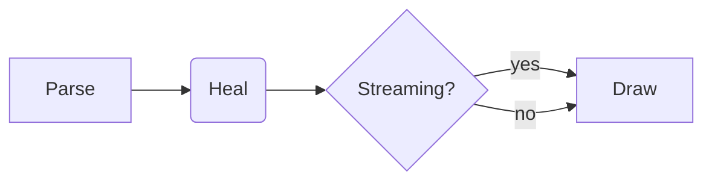

# Markdown in the chat

The parser and the drawing share code with the reader. This paragraph sits right after a heading.

A second paragraph follows the first one with no heading between them.

## Inline styles

Text can be **bold**, *italic*, ***bold and italic***, ~~struck through~~, or `inline code`. Code can sit inside bold: **run `go test ./...` first**. It can sit inside a link: [the `Parse` function](https://pkg.go.dev/github.com/yuin/goldmark). A bare URL such as https://github.com/quanticstudios/pitwall should be clickable too, and so should a path like `internal/ui/panel/chatreply.go:47`.

### Lists

- A bullet item
- A bullet item with **bold** and `code`
  - A nested item
  - Another nested item that runs long enough to wrap onto a second line, so the hanging indent shows where the text starts
    1. Third level, numbered
- Back to the top level

1. First step
2. Second step, with a code block inside:

   ```sh
   mise exec -- go test ./internal/ui/...
   ```

3. Third step

- [x] Parse inline styles
- [ ] Draw them

#### Quotes

> A block quote with *emphasis* and `code`.
>
> > A nested quote.

## Code

```go
func (d *cdraw) markdown(gtx layout.Context, id string, r *reply) layout.Dimensions {
	return layout.Dimensions{Size: image.Pt(gtx.Constraints.Max.X, 0)} // a long trailing comment that runs past the edge of the column to force sideways scrolling
}
```

```diff
--- a/chatreply.go
+++ b/chatreply.go
@@ -12,3 +12,4 @@
 unchanged line
-removed line
+added line
+another added line
```

## Tables

| Check                                                                                              |  Status  |   Time |
| :------------------------------------------------------------------------------------------------- | :------: | -----: |
| `go vet ./...`                                                                                     | ✓ passed |   1.2s |
| `go test ./...`                                                                                    | ✗ failed |  48.9s |
| A cell with much wider content that makes the table wider than the reply column on a narrow window |    ✓     |   0.1s |

## Diagrams and images




---

<details>
<summary>Details block</summary>

Hidden text inside details.

</details>

Done ✓, one failure ✗, and an emoji 🚀 at the end. This last paragraph is long on purpose: it keeps going so the measure of the column shows, how long lines wrap at about ninety-six characters, and whether the line height of 1.6 reads comfortably over several lines of prose without any markup at all.
